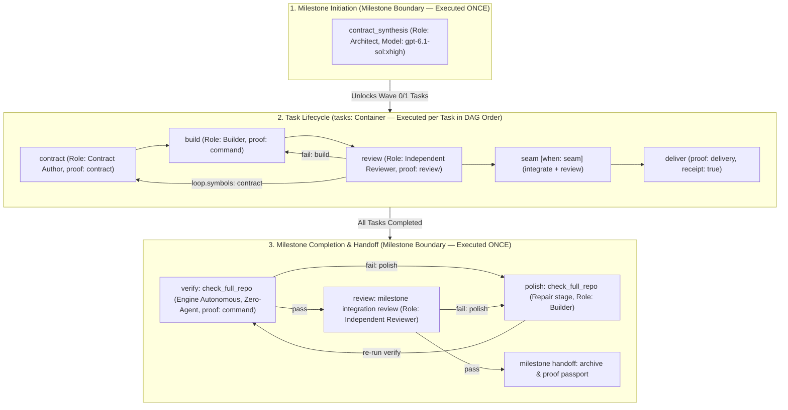

# ACDD Lifecycle Segregation, Fallback Code Elimination, and Verification Integrity

## Baseline closure before AC-003

The six original baseline reproductions were repaired, and PR-02 (the language-specific seam collector compatibility regression) is resolved via universal declarative output proof collection (`commands.output.tests`) in strict accordance with ADR 0020's zero-language-hardcode boundary. The shipped `seam.integrate` command succeeds and records authentic passed test identities. Count consistency, target ambiguity resolution, and element-by-element verification strictly prevent forged output and false attribution across targets. The remaining architectural graph/retry/replay work (M1/M2/M5) and native Workflow/Plan execution belong to [AC-003](../milestones/AC-003-headless-orchestrator-and-role-runners.md); unchecked architectural targets below remain deferred, not delivered claims. Supported reconciliation of AC-003's legacy operational rows remains a coordinator admission step before execution.

> [!IMPORTANT]
> Round 4 (`/tmp/forge-round4-audit-1793786772/ROUND-4-REPORT.md`) reopened lifecycle and verification acceptance. The subsequent Option A and BF-01–BF-06 repairs address the bounded baseline defects; their current verification and independent confirmation are recorded in the [freeze review receipt](acdd-baseline-freeze-review.md#baseline-remediation-receipt). This does not close M1/M2/M5: unified root/container interpretation, universal root retry accounting, and immutable historical-condition replay belong to AC-003. Native Workflow and Plan execution and autonomous run logs also remain planned there.

## 1. Executive Summary & Problem Diagnosis

During Milestone `UX-002` and the bootstrap of `AC-003`, two structural lifecycle defects emerged in the ACDD engine:

1. **Gate Flattening Defect (`contract_synthesis` leakage)**:
   In `crates/forge-tasks/src/engine/claim.rs:78-98` (`collect_cursors`), the engine iterated through all root entries in `profile.gates` and flattened both top-level gates (e.g. `contract_synthesis`) and nested task gates (`tasks.gates`) into a single linear sequence. Consequently, every single task in a milestone inherited `contract_synthesis` (Architect) as its initial gate, followed immediately by `tasks.contract` (Contract Author), forcing agents to author duplicate contract seam tests for every task.
2. **Fallback Over-Engineering & Verification Evasion**:
   In `crates/forge-tasks/src/milestones/handoff.rs`, a bespoke 7-state machine (`MilestoneVerificationPhase`, `GateFallback`, `fallback_*` actions) was added exclusively for milestone verification. Instead of using the universal `fail` and `loop` transitions, this parallel state machine introduced dead code and allowed an evasion path where clean working trees or client-supplied `--evidence-file` JSON bypassed autonomous full-suite verification (`cargo test --all-targets`), permitting broken tests to land in `main`.
3. **Audited Engine Findings**:
   A deep audit conducted by Codex Sol xhigh ([docs/plans/gate-engine-bugs-and-coverage-audit.md](gate-engine-bugs-and-coverage-audit.md)) uncovered 32 structural findings across the engine, including:
   - **F18 (P0)**: External JSON handoff verification bypass.
   - **F22 (P0)**: Unobserved mechanical proof acceptance.
   - **F26 (P0)**: Whole-index wipeout during `git_scoped_commit` (clearing unrelated staged work).
   - **F05 (P1)**: Historical lexical forward failure-edge validation defect (`verify -> fail: polish`).
   - **F10 (P1)**: Skipped conditional gates causing missing snapshot errors during delivery.

---

## 2. Core Architectural Model: Milestone Lifecycle vs Task Lifecycle

In accordance with [ADR 0020](../adr/0020-hierarchical-acdd-gates-and-milestone-orchestration.md) and [ADR 0021](../adr/0021-workflow-plan-and-milestone-lifecycle-hierarchy.md), the system distinguishes three distinct work models:



---

## 2.1 Model and profile boundaries

[ADR 0021](../adr/0021-workflow-plan-and-milestone-lifecycle-hierarchy.md) specifies the three subjects. A Workflow has only root gates, no task rows, and defaults to `save: none`; a Plan uses only `tasks:`, runs in place with snapshots and no automatic commits; a Milestone combines root gates, a task DAG, verification, review, and handoff. Native `workflow run` and `plan run`, autonomous role dispatch, and run logs are planned for AC-003. Validating these profiles does not execute them.

## 3. Unified milestone graph and remaining removal

The target places synthesis, `tasks:`, verification, repair, review, and handoff in one root `gates:` graph using `when`, `pass`, `fail`, and `loop`. Root operations exist, but R4-05–R4-07 and R4-15 establish that execution, checkpoint replay, and the separate phase and fallback machinery have not yet been unified. Remove the parallel authority only with a fail-closed persisted-state recovery path and production-seam proof.

## 4. Engine-observed verification target

Mandatory milestone verification uses an engine-owned observation bound to the current command plan, output policy, candidate, and target base. Common task acceptance requires observed contract, command, and seam-test proof; seam-test references require individually passed tests, not aggregate counts. Handoff and archived retries require a matching authoritative closed root checkpoint. The freeze review records the production regressions and final checks for these bounded repairs. Universal graph interpretation and root failure routing remain AC-003 work (M1/M2); immutable historical-condition replay remains M5.

---

## 5. Seam Gate Lifecycle & Candidate Resolution on Skipped Gates (Fix F10)

1. **Conditional Seam Semantics (`when: seam`)**:
   - The `seam` gate container (`integrate` $\to$ `review`) is conditional. In `crates/forge-tasks/src/engine/claim.rs`, `when: seam` evaluates to `true` strictly for concurrent tasks (`Speculative` or `Parallel`).
   - Sequential tasks cleanly skip `seam` and advance directly from task `review` to `deliver`.
2. **Resolution of Prior Snapshots on Delivery (Fix F10)**:
   - In `crates/forge-tasks/src/store/mod.rs` (`build_snapshot_candidate`) and `crates/forge-tasks/src/engine/gates.rs` (delivery gate verification), the engine previously selected the statically last `sha_snapshot` gate (`seam.integrate`). When `seam` was skipped, this produced missing snapshot errors despite an accepted `build` snapshot.
   - The skipped-seam case can use an earlier accepted snapshot. R4-08 found that integrated-candidate and review provenance still differ between delivery and handoff; explicit shared bindings remain required.
3. **No Artificial `TASK_DECISION_MISSING` Runtime Gate**:
   - To prevent message explosion on `task_blackboard` across repeated rejection and repair loops, we avoid hardcoding a rigid `TASK_DECISION_MISSING` check in `submit.rs`.
   - Evidence is an observed runtime-red seam test (`proof: contract` with `exit_codes: [1, 101, 134]` and `stderr_contains: "assertion failed"`) plus independent review contours. Common acceptance now checks the claim-bound recorded result; BF-01 extends that boundary to seam-test proof. Blackboard decision recording remains guidance in the profile without rigid SQLite blocking.

---

## 6. Git Index Preservation on Scoped Commits (Fix F26)

In `crates/forge-tasks/src/git.rs:624`, replace global `git read-tree HEAD` with selective path-scoped index synchronization:
```bash
git --literal-pathspecs reset --quiet <new-head> --pathspec-from-file=- --pathspec-file-nul
```
Only the files committed by the active task are updated in the developer's real index; all unrelated staged additions, edits, or deletions are strictly preserved. This fixes the failing test `scoped_commit_commits_staged_deletion_and_preserves_unrelated_staged_work`.

---

## 7. Phased Implementation Roadmap

- [x] **Phase 1: Scoped index preservation**: Round 4 verified literal, NUL-delimited scoped reset and preservation of unrelated staged paths (R3-13).
- [ ] **Phase 2: Task gate isolation**: Baseline repairs cover track-local references, applicable container exits, selected-track predecessor requirements, and durable receipt identity. General root synthesis/container unification remains M1 under AC-003.
- [ ] **Phase 3: Candidate and recovery**: Baseline repairs bind final handoff candidate/target and preserve authoritative closed proof across pruning/retry. Historical replay against immutable source remains M5 under AC-003.
- [ ] **Phase 4: Handoff verification and proof security**: Baseline task proof bypasses and handoff retry bypasses are repaired with observed evidence. Universal root failure transitions/counters remain M2 under AC-003.
- [ ] **Phase 5: Workflow and Plan execution**: Profile registration and validation are verified; native execution and run logs remain planned for AC-003. Schema validation is not end-to-end execution.
- [ ] **Unified graph and removal of parallel lifecycle machinery**: R4-05, R4-06, and R4-15 remain open.

---

## 8. Proposed Lifecycle Metadata Cleanup & Archive Commands

The commands in this section are proposed, not available runtime guarantees.

To ensure plans and workflows do not accumulate orphan snapshots, stale blackboard messages, or unbounded run logs:

1. **Commands**:
   - `contextunity-forge-mcp plan archive <path>`:
     - Relocates completed plan manifest to `docs/plans/archive/`.
     - Prunes Git snapshot refs (`refs/forge/snapshots/<slug>/*`).
     - Cleans SQLite `tasks`, `task_blackboard`, and `gate_execution_traces` for the plan.
   - `contextunity-forge-mcp plan clear <path_or_slug>`:
     - Purges snapshots and SQLite state without moving the markdown document.
   - `contextunity-forge-mcp workflow clear <name>`:
     - Clears execution run logs in `.forge/runs/<name>*` and SQLite traces.
   - `contextunity-forge-mcp milestone clear <id>`:
     - Purges stale/cancelled milestone state and SQLite records.
   - Universal command: `contextunity-forge-mcp clear <plan|milestone|workflow> <identifier> [--archive] [--all]`.

---

## 9. Post-AC-003 Testing Strategy (Verification Milestone / Workflow)

Upon delivering the AC-003 orchestrator runtime, an end-to-end verification suite will be executed:
1. **Dedicated Verification Milestone (AC-004 / `engine-gates-e2e.workflow.yaml`)**:
   - Tests pure workflow execution: `save: log`, multi-gate cycle, zero task records.
   - Tests plan execution: `save: snapshot`, in-place tasks, zero auto-commits, and verifies `plan archive` cleans up snapshots.
   - Tests milestone execution: 3-tier lifecycle, boundary gate enforcement, zero `contract_synthesis` leakage to tasks, autonomous `verify` gate (`check_full_repo`).

