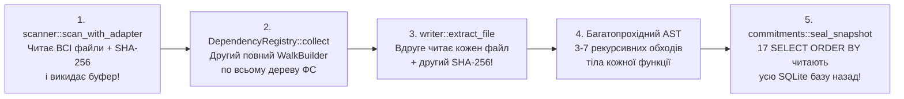
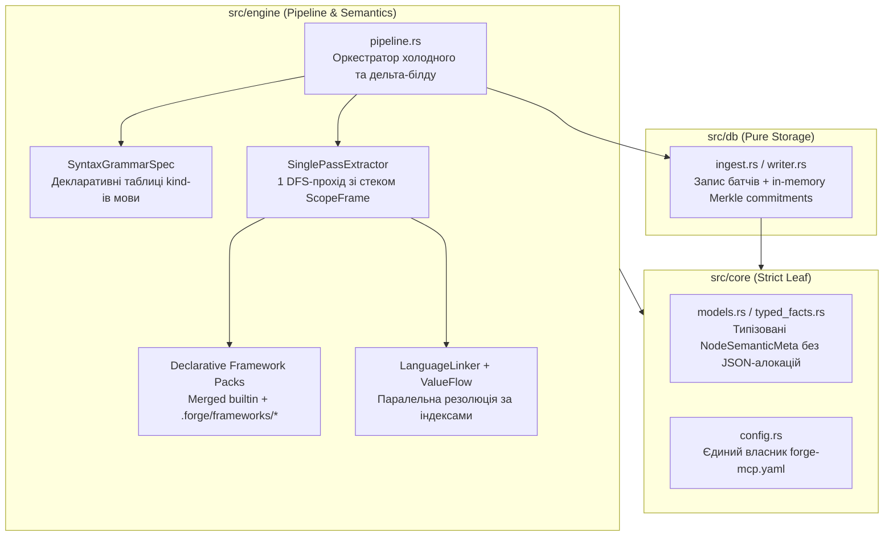

# Технічний аудит та архітектурний аналіз `contextunity-forge-mcp`

## 1. Аудит документації, ADR, архітектурних документів, скілів та `references/`

Перевірено всі документи у [`docs/`](file:///home/oleksii/ContextUnity/projects/contextunity-forge-mcp/docs/README.md), [` docs/adr/0001..0018`](file:///home/oleksii/ContextUnity/projects/contextunity-forge-mcp/docs/adr/README.md), [`README.md`](file:///home/oleksii/ContextUnity/projects/contextunity-forge-mcp/README.md), [`TESTS.md`](file:///home/oleksii/ContextUnity/projects/contextunity-forge-mcp/TESTS.md), [`AGENTS.md`](file:///home/oleksii/ContextUnity/projects/contextunity-forge-mcp/AGENTS.md), [`src/AGENTS.md`](file:///home/oleksii/ContextUnity/projects/contextunity-forge-mcp/src/AGENTS.md), [`skills/contextunity-forge/`](file:///home/oleksii/ContextUnity/projects/contextunity-forge-mcp/skills/contextunity-forge/SKILL.md) та встановлений глобальний скіл [`~/.agents/skills/contextunity-forge/`](file:///home/oleksii/.agents/skills/contextunity-forge/SKILL.md) проти реалізації у `src/` (118 файлів, 66 739 LOC).

### 1.1. Розбіжності між документацією (`docs/`, `README.md`, `TESTS.md`) та кодом (`src/`)

| Категорія | Локація в документації | Реальна реалізація в `src/` | Вплив / Суть розбіжності |
|---|---|---|---|
| **Невалідна схема профілю в прикладі** | [profiles.md](file:///home/oleksii/ContextUnity/projects/contextunity-forge-mcp/docs/reference/profiles.md#L35-L85) | [`GateProfile`](file:///home/oleksii/ContextUnity/projects/contextunity-forge-mcp/src/core/tasks/profile.rs#L270-L517) | Приклад у `profiles.md` не проходить десеріалізацію `GateProfile`: використовує `proof: { kind: contract }` замість рядка `proof: contract` або `{ scheme: ... }`; додає неіснуюче поле `command` всередину гейту `build` (`GateDef` має `deny_unknown_fields`); пропускає обов'язкове `review_sources: [review]` у `deliver`; описує `contours.default` як список рядків замість мапи `standard` з об'єктами `{ description, criteria }`. |
| **Суперечність щодо `TASK_GUIDANCE_MISSING`** | [configuration.md](file:///home/oleksii/ContextUnity/projects/contextunity-forge-mcp/docs/reference/configuration.md#L74-L78), [tasks.md](file:///home/oleksii/ContextUnity/projects/contextunity-forge-mcp/docs/reference/tasks.md#L89-L90), [README.md](file:///home/oleksii/ContextUnity/projects/contextunity-forge-mcp/README.md#L241) | [`guidance_gap`](file:///home/oleksii/ContextUnity/projects/contextunity-forge-mcp/src/engine/tasks/workspaces.rs#L215-L258) | `configuration.md:76-78` стверджує, що перевіряється `docs/reference/acdd.md`, а відсутній `agents_guidance` не викликає попередження. Насправді `workspaces.rs` взагалі не перевіряє `acdd.md`, а генерує `TASK_GUIDANCE_MISSING` у 4 випадках: `MissingFile` (`agents_guidance`), `MissingSkillReference` (`contextunity-forge`), `SkillNotInstalled` (`SKILL.md`), та `ForgeGitignoreInvalid` (канонічний 11-рядковий блок у кінці `.gitignore`, який не згаданий у `tasks.md` та `README.md`). |
| **Застаріла кількість MCP-інструментів та шляхи модулів** | [indexing.md](file:///home/oleksii/ContextUnity/projects/contextunity-forge-mcp/docs/architecture/indexing.md#L32-L33), [concurrency.md](file:///home/oleksii/ContextUnity/projects/contextunity-forge-mcp/docs/architecture/concurrency.md#L22), [tasks.md](file:///home/oleksii/ContextUnity/projects/contextunity-forge-mcp/docs/reference/tasks.md#L9-L10) | [`tools.rs`](file:///home/oleksii/ContextUnity/projects/contextunity-forge-mcp/src/mcp/tools.rs#L537), [`src/engine/tasks/`](file:///home/oleksii/ContextUnity/projects/contextunity-forge-mcp/src/engine/tasks/mod.rs), [`src/db/tasks_store/`](file:///home/oleksii/ContextUnity/projects/contextunity-forge-mcp/src/db/tasks_store/mod.rs) | У `indexing.md` вказано 15 MCP-інструментів замість 20 зареєстрованих; посилання вказують на монолітні `src/engine/scanner.rs`, `src/engine/tasks.rs` та `src/db/tasks_store.rs`, які були декомпозовані у директорії модулів. |
| **Неіснуюча CLI-команда та опис `guide init`** | [README.md](file:///home/oleksii/ContextUnity/projects/contextunity-forge-mcp/README.md#L84-L102), [README.md:207](file:///home/oleksii/ContextUnity/projects/contextunity-forge-mcp/README.md#L207) | [`cli/mod.rs`](file:///home/oleksii/ContextUnity/projects/contextunity-forge-mcp/src/cli/mod.rs#L205-L230), [`cli/guide.rs`](file:///home/oleksii/ContextUnity/projects/contextunity-forge-mcp/src/cli/guide.rs#L6-L25) | Таблиця у `README.md:207` вказує неіснуючу команду `query sql` (фактично `query run sql` або `query analyze 'SELECT ...'`). Шаблон `guide init` у `guide.rs` генерує лише 7 рядків (`roots: [.]` та `ignore`), а не розширений конфіг з `README.md:84-102`. Команда `guide adapter` повертає неповний список ключів (без `tasks_*`, `acdd_profile`, `response`, `limits`). |
| **Авто-побудова індексу в CLI** | [cli.md](file:///home/oleksii/ContextUnity/projects/contextunity-forge-mcp/docs/reference/cli.md#L58), [indexing.md](file:///home/oleksii/ContextUnity/projects/contextunity-forge-mcp/docs/architecture/indexing.md#L41) | [`open_or_rebuild`](file:///home/oleksii/ContextUnity/projects/contextunity-forge-mcp/src/cli/mod.rs#L304-L324) | Документація стверджує, що CLI `query`/`docs`/`ast` ніколи не будують індекс автоматично. Фактично `open_or_rebuild` автоматично викликає `build_index`, якщо `.forge/code-map.sqlite` відсутній або має застарілу схему (але не робить інкрементальний refresh при зміні mtime). |
| **Застарілі назви гейтів та биті посилання** | [TESTS.md](file:///home/oleksii/ContextUnity/projects/contextunity-forge-mcp/TESTS.md#L16), [testing/README.md](file:///home/oleksii/ContextUnity/projects/contextunity-forge-mcp/docs/testing/README.md#L34), [042-plan](file:///home/oleksii/ContextUnity/projects/contextunity-forge-mcp/docs/plans/042-universal-ast-search-and-tool-navigation.md#L14) | [`acdd.default.yaml`](file:///home/oleksii/ContextUnity/projects/contextunity-forge-mcp/src/core/tasks/acdd.default.yaml#L73) | Згадується старий гейт `build/v1` замість `build`; план 042 посилається на `../milestones/042-...` замість `../milestones/archive/042-...`. |

### 1.2. Стан ADR (`docs/adr/0001..0018`)
- **ADR 0002–0014, 0017, 0018** повністю відповідають реалізації.
- **[ADR 0001](file:///home/oleksii/ContextUnity/projects/contextunity-forge-mcp/docs/adr/0001-dual-surface-parity.md#L26)** перелічує історичні підмодулі `src/core/` (`graph`, `semantic`, `docs`, `compact`), тоді як зараз у `src/core/` знаходяться `adapter.rs`, `commitments.rs`, `fs.rs`, `git.rs`, `models.rs`, `response.rs`, `schema.rs`, `semantic.rs`, `sys.rs`, `tasks/`, `typed_facts.rs`.
- **[ADR 0015](file:///home/oleksii/ContextUnity/projects/contextunity-forge-mcp/docs/adr/0015-acdd-lifecycle-snapshots-and-proactive-defect-resolution.md#L28-L34)** та **[ADR 0016](file:///home/oleksii/ContextUnity/projects/contextunity-forge-mcp/docs/adr/0016-lean-stage-tailored-task-context-bundles.md#L27-L31)** відображають старі ідентифікатори стадій `contract/v1..deliver/v1` (до переходу на декларативні профілі) та первинну матрицю полів `context_bundle`, яка у [`context.rs`](file:///home/oleksii/ContextUnity/projects/contextunity-forge-mcp/src/engine/tasks/context.rs#L782-L880) була розширена полями `expected_evidence_template`, `external_callers` та `unresolved_review_findings`.

### 1.3. Розсинхронізація скілів та помилки у `skills/contextunity-forge/references/`

> [!WARNING]
> Встановлений глобальний скіл у [`~/.agents/skills/contextunity-forge/`](file:///home/oleksii/.agents/skills/contextunity-forge/SKILL.md) (на який вказує симлінк `~/.gemini/config/skills/contextunity-forge`) відстає від репозиторної версії [`skills/contextunity-forge/SKILL.md`](file:///home/oleksii/ContextUnity/projects/contextunity-forge-mcp/skills/contextunity-forge/SKILL.md), а самі файли у `references/` містять конфігураційні помилки.

1. **Відставання встановленого `~/.agents/skills/contextunity-forge/` від репозиторію**:
   - У глобальному `SKILL.md` (240 рядків проти 246 у репо) відсутні опис `task next` / `task_manage(action: "next")`, guardrail `NO_PREFLIGHT_SUBAGENTS`, інструкції щодо публікації чернетки контракту в `task_blackboard(topic=draft, gate=build)`, коди `TASK_SEAM_DISCONNECTED` / `TASK_SCOPE_INCOMPLETE`, та статус `parked`.
   - Глобальний `references/acdd_profile.yaml.example` використовує стару команду `cargo-test` та окрему роль `delivery_reviewer`.
   - Водночас репозиторні копії [`skills/test-contract-seam/SKILL.md`](file:///home/oleksii/ContextUnity/projects/contextunity-forge-mcp/skills/test-contract-seam/SKILL.md) та [`skills/test-suite-refactor/SKILL.md`](file:///home/oleksii/ContextUnity/projects/contextunity-forge-mcp/skills/test-suite-refactor/SKILL.md) є урізаними порівняно з розширеними глобальними версіями у `~/.agents/skills/`.
2. **Помилки у [`skills/contextunity-forge/references/forge-mcp.yaml.example`](file:///home/oleksii/ContextUnity/projects/contextunity-forge-mcp/skills/contextunity-forge/references/forge-mcp.yaml.example)**:
   - Містить неіснуючий ключ `project_id: "forge-mcp"` (канонічні ключі — `task_repository` та `task_project`).
   - Містить верхньорівневий скаляр `milestones_dir: "docs/milestones"`, який **ігнорується** парсером (`AdapterFile` та `TaskSettings` читають на верхньому рівні список `milestones: [docs/milestones]`; `milestones_dir` існує лише всередині `linked_workspaces[].tasks`).
3. **Помилка у [`skills/contextunity-forge/references/acdd_profile.yaml.example`](file:///home/oleksii/ContextUnity/projects/contextunity-forge-mcp/skills/contextunity-forge/references/acdd_profile.yaml.example#L53-L56)**:
   - Рядок 53 наказує публікувати чернетку з `gate=build`, але на рядку 56 гейт названий `id: implement` (гейту `build` у цьому файлі немає), що при виклику [`validate_blackboard_schema`](file:///home/oleksii/ContextUnity/projects/contextunity-forge-mcp/src/engine/tasks/blackboard.rs#L445-L455) дасть помилку `TASK_BLACKBOARD_SCHEMA_INVALID`.
4. **Неточності у [`skills/contextunity-forge/SKILL.md`](file:///home/oleksii/ContextUnity/projects/contextunity-forge-mcp/skills/contextunity-forge/SKILL.md)**:
   - У прикладі `linked_workspaces[].tasks` (рядки 181–184) вказані поля `repository` та `project`, які ігноруються структурою [`LinkedTasks`](file:///home/oleksii/ContextUnity/projects/contextunity-forge-mcp/src/engine/tasks/workspaces.rs#L24-L32).
   - У `code_map_overview` (рядок 218) вказано неіснуючий аргумент `include_gaps?` замість `aspects?`.
   - У списку guardrails (рядки 101–106) пропущено 6-те правило `NEVER_EDIT_RECEIPTS` з [`workflow_rules`](file:///home/oleksii/ContextUnity/projects/contextunity-forge-mcp/src/engine/tasks/workspaces.rs#L545-L552).
5. **Відсутність прикладів маніфестів фреймворків у `references/`**:
   - У `skills/contextunity-forge/references/` немає жодного прикладу `.forge/frameworks/<framework>.toml` або `.yaml`.
   - У корені `.forge/` самого репозиторію залишився застарілий дубль [`.forge/acdd_profile.yaml`](file:///home/oleksii/ContextUnity/projects/contextunity-forge-mcp/.forge/acdd_profile.yaml) поряд із активним [`.forge/acdd/profile.yaml`](file:///home/oleksii/ContextUnity/projects/contextunity-forge-mcp/.forge/acdd/profile.yaml).

---

## 2. Поточна модульність, архітектура парсерів та винесені налаштування фреймворків

### 2.1. Аналіз модульності `src/` та зв'язаності шарів

Наразі **70.8% усього коду** (47 264 із 66 739 LOC) зосереджено в `src/engine/`, причому спостерігаються чотири структурні проблеми:

1. **Заморожений циклічний імпорт `src/db` ↔ `src/engine`**:
   - [`src/db/writer.rs`](file:///home/oleksii/ContextUnity/projects/contextunity-forge-mcp/src/db/writer.rs#L6-L9) та [`src/db/delta.rs`](file:///home/oleksii/ContextUnity/projects/contextunity-forge-mcp/src/db/delta.rs#L6-L10) напряму імпортують `engine::{ast, docs, languages, linker, scanner}` і виступають оркестраторами всього пайплайну індексації, тоді як `engine::ast::search` і `engine::tasks` імпортують `src/db`.
2. **Аномалія підключення мовних підмодулів через `#[path = "..."]`**:
   - [`build.rs`](file:///home/oleksii/ContextUnity/projects/contextunity-forge-mcp/build.rs#L95-L154) генерує реєстр у `OUT_DIR/language_profiles.rs`. Оскільки `python.rs`, `rust.rs`, `html.rs`, `vue.rs` лежать у `src/engine/languages/` як плоскі файли, а їхні підмодулі — у підпапках, використовується каскад `#[path = "python/..."]`.
   - Більше того, [`src/engine/languages/mod.rs`](file:///home/oleksii/ContextUnity/projects/contextunity-forge-mcp/src/engine/languages/mod.rs#L31-L41) повторно монтує `#[path = "python/receivers.rs"] pub(crate) mod python_receivers;` та `#[path = "typescript/linker_bindings.rs"] pub(crate) mod typescript_bindings;` поза feature-флагами, бо лінкер (`src/engine/linker/`) жорстко прив'язаний до внутрішніх типів Python і TypeScript.
3. **Розпорошена конфігурація**:
   - Парсинг `forge-mcp.yaml` знаходиться всередині сканера ([`src/engine/scanner/adapter.rs`](file:///home/oleksii/ContextUnity/projects/contextunity-forge-mcp/src/engine/scanner/adapter.rs)), налаштування задач — у [`src/engine/tasks/mod.rs`](file:///home/oleksii/ContextUnity/projects/contextunity-forge-mcp/src/engine/tasks/mod.rs#L247-L275), профілі ACDD — у [`src/core/tasks/profile.rs`](file:///home/oleksii/ContextUnity/projects/contextunity-forge-mcp/src/core/tasks/profile.rs), а маніфести фреймворків — у [`src/engine/languages/dependency_registry.rs`](file:///home/oleksii/ContextUnity/projects/contextunity-forge-mcp/src/engine/languages/dependency_registry.rs#L383-L515).
4. **Нетипізована передача AST-фактів у лінкер через JSON (`Node.details`)**:
   - [`src/engine/ast/mod.rs`](file:///home/oleksii/ContextUnity/projects/contextunity-forge-mcp/src/engine/ast/mod.rs#L508-L548) пакує внутрішні таблиці `bindings`, `rebindings`, `receiver`, `param_types` у `serde_json::Value` кожного `Node`, після чого лінкер повторно розпарсює їх через `node.details["bindings"].as_array()`, а перед записом у SQLite [`Node::navigation_details`](file:///home/oleksii/ContextUnity/projects/contextunity-forge-mcp/src/core/models.rs#L163-L173) клонує JSON-об'єкт і видаляє ці тимчасові ключі.

### 2.2. Як зараз влаштовані винесені налаштування фреймворків (`FrameworkManifest`)

Відповідно до [ADR 0013](file:///home/oleksii/ContextUnity/projects/contextunity-forge-mcp/docs/adr/0013-data-driven-framework-manifests.md) та [ADR 0017](file:///home/oleksii/ContextUnity/projects/contextunity-forge-mcp/docs/adr/0017-serde-framework-manifest-formats.md):
- У бінарник вбудовано 4 TOML-маніфести в `src/engine/languages/manifests/`:
  - [`alpinejs.toml`](file:///home/oleksii/ContextUnity/projects/contextunity-forge-mcp/src/engine/languages/manifests/alpinejs.toml) (`receivers = ["$el", "$refs", "$event", "$dispatch", "$nextTick", "$watch", "$store", "$data", "$id", "$root", "$parent"]`)
  - [`django.toml`](file:///home/oleksii/ContextUnity/projects/contextunity-forge-mcp/src/engine/languages/manifests/django.toml) (`receivers = ["template_context=django.shortcuts.render"]`, 24 `builtins`, 21 `filters`, 3 `routes`)
  - [`jinja2.toml`](file:///home/oleksii/ContextUnity/projects/contextunity-forge-mcp/src/engine/languages/manifests/jinja2.toml) (30 `builtins`, 19 `filters`)
  - [`nuxt.toml`](file:///home/oleksii/ContextUnity/projects/contextunity-forge-mcp/src/engine/languages/manifests/nuxt.toml) (5 `builtins`, `routes = ["components/**/*.vue"]`)
- Кожен воркспейс (включно з `linked_workspaces`) може визначити власні файли `<workspace>/.forge/frameworks/<framework>.{toml,yaml,yml}`, які завантажуються у [`load_framework_manifests`](file:///home/oleksii/ContextUnity/projects/contextunity-forge-mcp/src/engine/languages/dependency_registry.rs#L399-L515).

**Поточні архітектурні обмеження цього механізму:**
1. **Вимога декларації пакета в пакетному маніфесті (`declares_for_path`)**:
   - Метод [`framework_manifest_for_path`](file:///home/oleksii/ContextUnity/projects/contextunity-forge-mcp/src/engine/languages/dependency_registry.rs#L275-L289) повертає маніфест (як кастомний з `.forge/frameworks/`, так і вбудований!) **тільки якщо** `declares_for_path(family, path, package)` знаходить відповідний пакет (`"alpinejs"`, `"django"`, `"jinja2"`, `"nuxt"`) у `package.json` або `pyproject.toml`/`requirements*.txt` цього воркспейсу.
   - **Наслідок для проектів з Alpine.js / HTMX**: якщо Alpine.js підключається у Django-шаблоні через `<script src="...">` або вендорний бандл без запису `"alpinejs"` у `package.json`, то **правила `alpinejs.toml` взагалі не активуються** (саме це відбувається у `commerce-release-update`, `grid-view-spec`, `traverse`, `nszu`, `grid-view-spec-demo`).
2. **Повне заміщення замість мерджу (`replace` vs `extend`)**:
   - Якщо проект створює `.forge/frameworks/django.toml`, щоб додати лише один власний template tag або `render`-хелпер, він повністю затирає вбудований `django.toml` і змушений копіювати всі 48 стандартних правил Django.
3. **90% фреймворкової логіки все ще захардкоджено в Rust поза маніфестами**:
   - Методи базових класів `django.db.models.Model` (`objects.filter/get/all`), `BaseCommand`, `HttpRequest`, `TestCase` та `pydantic.BaseModel` захардкоджені у [`src/engine/languages/python/receivers.rs`](file:///home/oleksii/ContextUnity/projects/contextunity-forge-mcp/src/engine/languages/python/receivers.rs#L311-L428).
   - Екстракція маршрутів Django (`path`, `re_path`), FastAPI (`@app.get`, `@router.post`) та NestJS (`@Get`, `@Post`) захардкоджена у [`src/engine/ast/routes.rs`](file:///home/oleksii/ContextUnity/projects/contextunity-forge-mcp/src/engine/ast/routes.rs#L19-L115).
   - Лінкер запитує у `DependencyRegistry` лише 4 захардкоджені імена фреймворків (`"django"`, `"jinja2"`, `"alpinejs"`, `"nuxt"`). Додати `.forge/frameworks/gridviewspec.toml` або `.forge/frameworks/fastapi.toml` без зміни коду лінкера зараз неможливо.

---

## 3. Аудит інтеграції у `commerce-release-update`, `rag-reconsolidation`, `gridviewspec`, `traverse` та інших проектах

Перевірено всі репозиторії, гілки та worktrees у `/home/oleksii/ContextUnity/`.

### 3.1. Зведена таблиця стану репозиторіїв та worktrees

| Репозиторій / Worktree | `forge-mcp.yaml` | `linked_workspaces` | `.forge/acdd/profile.yaml` | `.forge/frameworks/` | `.gitignore` блок `.forge` | Проблеми та невідповідності |
|---|---|---|---|---|---|---|
| **`worktrees/commerce-release-update`** (контрольний) | Є (гібридний v1 + tasks) | `traverse` (enabled), `gridviewspec` (enabled) | Є (повний: `test`, `pytest`, 4 ролі) | **Відсутній** (`0` файлів) | Валідний | 1) У `linked_workspaces[traverse].roots` вказано неіснуючу папку `pim`. 2) `tasks_db: .forge/tasks.sqlite` через git-common-dir резолвиться у `/home/oleksii/ContextUnity/contextunity/.forge/tasks.sqlite` (5.9 МБ) замість локальної БД (11.1 МБ). 3) `alpinejs.toml` не активується (немає `alpinejs` у `package.json`). |
| **`commerce-release-update/.worktrees/*`** (10 worktrees) | Є | `traverse`, `gridviewspec` | Є | **Відсутній** | Валідний | Відсутні нові поля `record_task_commits: false` та `commit_tracking: milestone_only`; у 2 worktrees застарілий шлях `types/django`. |
| **`contextunity/.worktrees/rag-reconsolidation`** (та `BS002-...`) | Є | `traverse` (enabled), `gridviewspec` (enabled) | Є (`profile.yaml` + `ingest-profile.yaml`) | **Відсутній** | Валідний (але є дублі перед блоком) | 1) Неіснуючий root `pim` для `traverse`. 2) `profile.yaml` має скорочений набір ролей (немає `contract_author`, `delivery_reviewer`). |
| **`contextunity`** (основний чекаут, гілка `phase5`) | **Застарілий** | Лише `gridviewspec` (`enabled: false`), немає `traverse` | **Відсутній** | **Відсутній** | **Невалідний** (старий `.forge/`) | Немає `task_repository`, `task_project`, `tasks_db`, `.forge/acdd/profile.yaml`, оновленого `AGENTS.md` та блоку `.gitignore`. |
| **`projects/grid-view-spec`** | Є (актуальний) | Немає | Є (незакомічений `M`) | **Відсутній** | Валідний | У `frontend/package.json` не задекларовано `alpinejs`, тому Alpine-ресивери (`$el`, `$refs`, `$dispatch`) не лінкуються з `alpinejs.toml`. Немає специфічних правил фреймворку `gridviewspec`. |
| **`projects/traverse`** | Є (актуальний) | `gridviewspec` (`../grid-view-spec`) | Є | **Відсутній** | Валідний у main, **зламаний у worktree `TR101`** | У `.worktrees/TR101-universal-storefront-channel`: 1) відносний шлях `../grid-view-spec` у `forge-mcp.yaml` вказує в нікуди; 2) у `.gitignore` після блоку `.forge` додано `.worktrees/`, що викликає `TASK_GUIDANCE_MISSING`. |
| **`projects/grid-view-spec-demo`** | Є (незакомічений `M`) | `gridviewspec` (`../grid-view-spec`) | **Відсутній** | **Відсутній** | **Невалідний** | Закінчується на `.forge/` без `!/.forge/acdd/**` та `!/.forge/frameworks/**`; немає `.forge/acdd/profile.yaml`. |
| **`projects/library`**, **`pinkpony`**, **`ethicalstylist`** | Є | Немає | **Відсутній** | **Відсутній** | **Невалідний** | У `AGENTS.md` немає точного імені скіла `contextunity-forge`; немає `.forge/acdd/profile.yaml` та блоку `.gitignore`. |
| **`projects/nszu`** | Чернетка (`??`) | `gridviewspec` (`../grid-view-spec`) | **Відсутній** | **Відсутній** | **Невалідний** | Немає `task_*` полів у `forge-mcp.yaml`, немає згадки `contextunity-forge` в `AGENTS.md`, немає `.forge/`. |

### 3.2. Відповіді на контрольні питання щодо інтеграції фреймворків
1. **Чи створені файли `.forge/frameworks/*` у проектах (`commerce-release-update`, `rag-reconsolidation`, `gridviewspec`, `traverse`)?**
   - **Ні.** У жодному з репозиторіїв чи worktrees директорія `.forge/frameworks/` ще не створена (хоча у `.gitignore` основних проектів правило `!/.forge/frameworks/**` вже додане).
2. **Чи є заповнені приклади цих файлів у репозиторії `contextunity-forge-mcp`?**
   - **Як окремих файлів-прикладів у `skills/contextunity-forge/references/` або `examples/` — немає.**
   - Повні робочі файли існують лише як вбудовані ресурси компілятора у [`src/engine/languages/manifests/`](file:///home/oleksii/ContextUnity/projects/contextunity-forge-mcp/src/engine/languages/manifests/) (`alpinejs.toml`, `django.toml`, `jinja2.toml`, `nuxt.toml`), а в [`docs/reference/framework-manifests.md`](file:///home/oleksii/ContextUnity/projects/contextunity-forge-mcp/docs/reference/framework-manifests.md#L30-L48) наведено лише мінімальний 4-рядковий сніпет схеми.

---

## 4. Як покращити модульність, уніфікувати парсери та підвищити якість індексації БЕЗ сповільнення холодної індексації

### 4.1. Чому холодна індексація зараз витрачає зайвий час (виявлені вузькі місця)

Аналіз [`src/db/writer.rs`](file:///home/oleksii/ContextUnity/projects/contextunity-forge-mcp/src/db/writer.rs#L34-L355), [`src/engine/scanner/mod.rs`](file:///home/oleksii/ContextUnity/projects/contextunity-forge-mcp/src/engine/scanner/mod.rs#L383-L397), [`src/engine/ast/mod.rs`](file:///home/oleksii/ContextUnity/projects/contextunity-forge-mcp/src/engine/ast/mod.rs#L319-L605) та [`src/core/commitments.rs`](file:///home/oleksii/ContextUnity/projects/contextunity-forge-mcp/src/core/commitments.rs#L156-L185) показав **5 прихованих витрат часу** під час холодної індексації:

1. **Подвійне читання кожного файлу з диска та подвійний SHA-256**:
   - [`scanner::scan_with_adapter`](file:///home/oleksii/ContextUnity/projects/contextunity-forge-mcp/src/engine/scanner/mod.rs#L383-L397) читає кожен файл у пам'ять (`fs::read`), рахує SHA-256 і відкидає вміст. Одразу після цього [`extract_file_with_invalidations`](file:///home/oleksii/ContextUnity/projects/contextunity-forge-mcp/src/db/writer.rs#L531-L537) повторно читає файл з диска (`fs::read_to_string`) і вдруге рахує SHA-256.
2. **Другий повний обхід файлової системи (`ignore::WalkBuilder`)**:
   - [`DependencyRegistry::try_collect_with_scan_config`](file:///home/oleksii/ContextUnity/projects/contextunity-forge-mcp/src/engine/languages/dependency_registry.rs#L107-L149) запускає окремий рекурсивний обхід усіх директорій воркспейсу та `linked_workspaces` для пошуку `package.json`, `pyproject.toml`, `tsconfig.json`, замість того щоб отримати знайдені маніфести від сканера за один прохід.
3. **Багатопрохідний (3–7 разів) обхід одного й того ж AST-дерева**:
   - В [`ast::extract_tree_with_flows`](file:///home/oleksii/ContextUnity/projects/contextunity-forge-mcp/src/engine/ast/mod.rs#L319-L605) на кожному файлі виконується `profile.prepare(root)`, потім кореневий `bindings(root)`, а далі під час `visit_node` на **кожній функції/класі** викликається `profile.declaration` (який запускає рекурсивний `value_flow::extract` по всьому тілу функції), потім `profile.bindings` (який запускає рекурсивний `scope_bindings` по всьому тілу функції), і нарешті сам `visit_node` втретє рекурсивно спускається у дочірні вузли!
   - У [`vue.rs`](file:///home/oleksii/ContextUnity/projects/contextunity-forge-mcp/src/engine/languages/vue.rs#L180-L227) дерево `<script setup>` обходиться **7 разів поспіль** різними `collect_*` функціями, а `Parser::new()` створюється вручну в обхід thread-local пулу.
4. **Неповний `PARSER_POOL`**:
   - Thread-local пул [`PARSER_POOL`](file:///home/oleksii/ContextUnity/projects/contextunity-forge-mcp/src/engine/languages/mod.rs#L692-L735) кешує парсери лише для 6 мов, а [`extract_typed`](file:///home/oleksii/ContextUnity/projects/contextunity-forge-mcp/src/engine/ast/mod.rs#L667-L683) використовує `with_warm_parser` лише для 4 мов (`python`, `rust`, `typescript`, `javascript`).
5. **Повне перечитування SQLite у `commitments::seal_snapshot`**:
   - Після вставки всіх таблиць у SQLite [`seal_snapshot`](file:///home/oleksii/ContextUnity/projects/contextunity-forge-mcp/src/core/commitments/snapshot.rs#L11-L109) виконує `SELECT ... FROM nodes/edges/references_table/local_facts ORDER BY ...` по всій базі, хоча всі ці вектори щойно були в пам'яті Rust під час `populate()`.

> [!TIP]
> Усунення лише подвійного читання/хешування файлів, другого `WalkBuilder` та перехід на однопрохідний обхід AST дають **25–40% запасу швидкості холодної індексації**, що дозволяє додати значно глибшу семантичну індексацію мов та фреймворків і при цьому **прискорити** холодний старт на контрольному репозиторії `commerce-release-update`.

---

### 4.2. Архітектура уніфікації парсерів мов та модульності

1. **Виділення `src/engine/pipeline.rs` та `src/core/config.rs` (розрив циклу `db` ↔ `engine`)**:
   - Перенести оркестрацію сканування, AST-екстракції та лінковки із `src/db/writer.rs` і `src/db/delta.rs` у `src/engine/pipeline.rs`. Шар `src/db` приймає готові типізовані батчі для запису.
   - Винести `AdapterFile` / `Adapter` із `src/engine/scanner/adapter.rs` у `src/core/config.rs`.
   - Прибрати змішування `python.rs` + `python/` на користь стандартних модулів `<lang>/mod.rs` та перенести контракти `ReceiverCatalog` / `TypeScriptBindings` у `src/core/semantic.rs`.
2. **Уніфікація `LanguageProfile` (47 методів → 3 чіткі рівні)**:
   - **Рівень 1 — `SyntaxGrammarSpec` (декларативна таблиця для швидкого підключення будь-якої мови за ~80 LOC)**: статичні таблиці `declaration_kinds`, `reference_kinds`, `scope_kinds`, `import_kinds`, `member_access_kinds`, `comment_kinds`.
   - **Рівень 2 — `SinglePassExtractor` (єдиний DFS-обхід дерева)**:
     - Під час спуску (`enter_node`) відкривається `ScopeFrame` (модуль → клас → функція → блок) і реєструються декларації.
     - На кожному вузлі всередині тіла функції в поточний `ScopeFrame` **за один прохід** записуються `bindings`, `rebindings`, локальні `ValueFlowFacts` (присвоєння, повернення, виклики) та `References`.
     - Під час підйому (`exit_node`) зібраний `ScopeFrame` прикріплюється до вузла функції без повторного обходу її піддерева.
   - **Рівень 3 — `LanguageLinker` (плагін крос-файлової семантики)**: резолюція імпортів, member lookup та framework packs.
3. **Заміна JSON `Node.details` на типізовану структуру `NodeSemanticMeta`**:
   - Зберігати `bindings`, `rebindings`, `receiver_hint`, `param_types` у типізованих векторах всередині `TypedFacts` замість серіалізації/десеріалізації через `serde_json::Value`.

---

### 4.3. Універсальні та мовно-специфічні покращення індексації (`ts`, `js`, `vue`, `html`, `python` + фреймворки)

Всі запропоновані нижче покращення працюють за $O(1)$ хеш-лукапів під час **єдиного проходу AST** та існуючої фази лінковки, тому **не додають жодного нового проходу по файлах**:

#### 1. Розширення схеми `.forge/frameworks/` (Declarative Framework Packs v2)
- **Режим `extend = true` (за замовчуванням)**: проектний маніфест у `.forge/frameworks/django.toml` або `alpinejs.toml` **доповнює** (merge) вбудований маніфест, а не затирає його (з опцією `replace = true`, якщо потрібне повне заміщення).
- **Авто-активація за наявністю файлу `.forge/frameworks/<id>.toml` або маркерами в коді**: якщо проект поклав `.forge/frameworks/alpinejs.toml` (або в HTML знайдено `x-data`), активувати правила Alpine.js навіть тоді, коли `alpinejs` підключений через CDN/вендорний скрипт і відсутній у `package.json`.
- **Нові декларативні секції маніфесту** (перенесення хардкоду з Rust у TOML/YAML):
  - `[[class_Hierarchy_receivers]]`: перенесення хардкоду з `python/receivers.rs` (`django.db.models.Model`, `BaseCommand`, `HttpRequest`, `pydantic.BaseModel`, а також `gridviewspec.GridViewSpec`) у маніфести.
  - `[[route_decorators]]` та `[[route_calls]]`: декларативний опис `@app.get`, `@router.post`, `@Controller` + `@Get`, `path(..., name=...)`.
  - `[[di_calls]]`: опис ін'єкції залежностей (`fastapi.Depends`, `Security`).
  - `[[template_attributes]]`: опис класових атрибутів шаблонів (`template_name` у Django CBV та `GridViewSpec`).

#### 2. Python + Django + GridViewSpec + FastAPI
- **Django `` → Backend Route**:
  - У [`ast/routes.rs`](file:///home/oleksii/ContextUnity/projects/contextunity-forge-mcp/src/engine/ast/routes.rs#L19-L35) під час розбору `path("...", view, name="order_list")` зберігати `name` (плюс `app_name` з `urls.py`) у метаданих вузла `route`.
  - У `html.rs` та `htmx.rs` при зустрічі `hx-get=""` або `<a href="">` резолвити ім'я маршруту за $O(1)$ через `HashMap<RouteName, NodeId>` у ребро `targets_route`!
- **Django `include("app.urls")` і префікси маршрутів**:
  - Фіксувати ребро `includes_urls` між `urls.py` файлами та конкатенувати префікси маршрутів у лінкері, щоб `hx-post="/api/v1/orders/create/"` точно знаходив вкладений `path("create/", ...)`.
- **Django Class-Based Views (CBV) та `GridViewSpec`**:
  - Під час обходу класу в Python екстрагувати класові атрибути `template_name = "..."`, `model = ...`, `spec = ...` / спадкування від `GridViewSpec` (або `GridView`). Це створить прямі ребра від класу в'юхи/спеки до HTML-шаблону (`renders_template`), моделі даних (`uses_model`) та HTMX-екшенів без додаткових витрат часу.
- **FastAPI `Depends()` та `APIRouter(prefix=...)`**:
  - У `python/declarations.rs` інтерпретувати значення за замовчуванням `svc = Depends(get_service)` та `Annotated[T, Depends(get_service)]` як виклик `get_service` + прив'язку return-типу `get_service` до параметра `svc` у `ValueFlowFacts`.
  - Склеювати `APIRouter(prefix="/items")` із декораторами `@router.get("/{id}")` та `app.include_router(router, prefix="/api")`.

#### 3. TypeScript / JavaScript + Vue 3 / Nuxt + NestJS
- **Однопрохідний парсинг `<script setup>` у Vue SFC**:
  - Об'єднати 7 окремих проходів `collect_*` у [`src/engine/languages/vue.rs`](file:///home/oleksii/ContextUnity/projects/contextunity-forge-mcp/src/engine/languages/vue.rs#L180-L227) в один прохід та перевести `vue.rs` і `vue/template.rs` на `with_warm_parser` із `PARSER_POOL`.
- **Pinia (`defineStore`) та Vue `provide`/`inject`**:
  - Розпізнавати `export const useCartStore = defineStore('cart', ...)` як фабрику стану (через вже наявний у `typescript/frameworks.rs` механізм `returned_object_fields`), щоб виклики `const cart = useCartStore(); cart.addItem()` у `.vue` та `.ts` файлах отримували точні ребра `calls` на методи стору.
- **NestJS `@Controller('/prefix')` + Constructor DI**:
  - Конкатенувати префікс класового декоратора `@Controller('/users')` із методом `@Get(':id')` у `ast/routes.rs`.
  - Враховувати типізовані параметри `constructor(private readonly userService: UserService)` як поля екземпляра класу (`this.userService`), що одразу підключає їх до існуючого `TypeScriptMembers` резолвера.

#### 4. HTML + HTMX + Alpine.js (Islands Architecture)
- **Зв'язування `Alpine.store('name', ...)` ↔ `$store.name.*` у шаблонах**:
  - У [`typescript/frameworks.rs`](file:///home/oleksii/ContextUnity/projects/contextunity-forge-mcp/src/engine/languages/typescript/frameworks.rs#L93-L185) при реєстрації `Alpine.store('cart', { open() {} })` створювати іменований receiver `alpine_store:cart`, а в JS-островах HTML (`x-data`, `@click="$store.cart.open()"`) резолвити звернення `$store.<name>.<member>` безпосередньо у визначення стору.
- **Зв'язування подій `$dispatch('event-name')` ↔ `@event-name.window` / `hx-trigger`**:
  - Фіксувати строкові літерали першого аргументу `$dispatch('grid:refresh')` та `HX-Trigger: grid:refresh` (на стороні Python/Django) і лінкувати їх із слухачами `@grid:refresh` та `hx-trigger="grid:refresh from:body"` у HTML/Vue.
