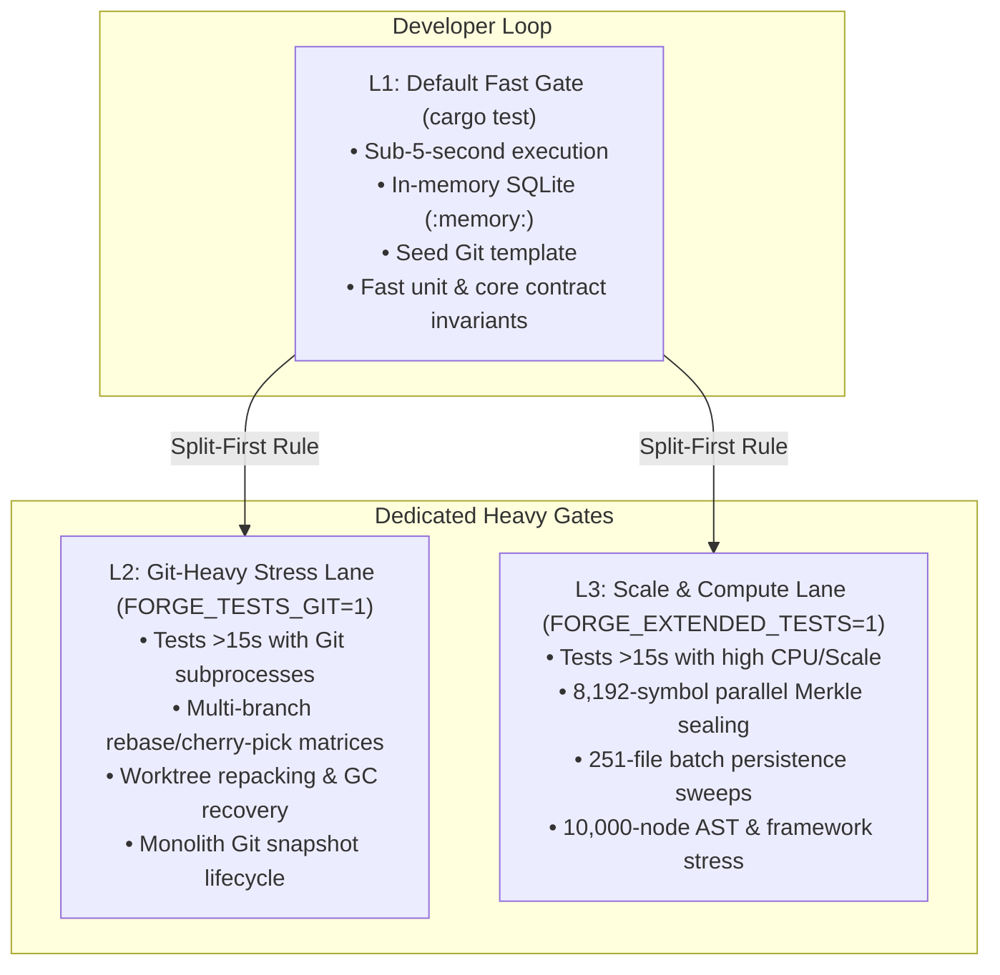

# Test Suite Diet, Fixture Hardening, and Sub-Second Developer Loop

## 1. Executive Summary & Audit Findings (Codex Sol Audit)

During Milestone `AC-003` iteration and architectural reviews, test suite execution ballooned to **811.71s wall time** (over 13.5 minutes sequential target wall time, 3,236s total CPU time across 868 registered integration tests).

On 2026-11-05, an independent adversarial audit conducted by `codex-sol-test-auditor` (`model_reasoning_effort="xhigh"`, report at `/tmp/forge-test-suite-audit.md` and `/tmp/forge-test-audit-evidence/`) uncovered two root problems:
1. **The 141-Workspace Subprocess Storm**: Across `tests/acdd/` alone, 141 tests invoke `ScopedWorkspace::new()`, each executing 6+ external `git` subprocesses (`git init`, `git config` x3, `git add`, `git commit`) and physical SQLite file migrations on disk, producing >850 process forks and thousands of physical disk fsyncs before any assertions run.
2. **Fixture Masking & Untrusted Proofs**:
   - **TQ-01 (Critical)**: Verification traces were checked via a naive `SELECT EXISTS(...)` query, allowing historical successful traces to authorize later failed verification handoffs.
   - **TQ-02 / TQ-03 (High)**: Generic fixtures in `tests/acdd/support.rs` silently intercepted YAML profile writes, replacing production commands with synthetic runner fixtures and simulating red/green states via `FORGE_FIXTURE_RED` rather than executing genuine application seams.
   - **TQ-04 (High)**: Shared extractor cache across workspaces caused flakiness and cross-test contamination in `storage_batches`.
   - **TQ-05 (High)**: The root `cargo test --all-targets` command omitted member unit tests (`cargo test -p forge-tasks --lib`).
   - **TQ-06 (Medium)**: `ScopedWorkspace::new` mutated process-wide environment variables without thread isolation.

---

## 2. Empirical Timing Inventory (Slowest Tests > 15-20s)

The diagnostic profiling measured per-test wall clock time across all integration test suites. The tests exceeding the 15-20 second threshold are:

| Test Case | Area / Target | Elapsed Time | Primary Bottleneck | Target Gating |
| :--- | :--- | :---: | :--- | :--- |
| `handoff_rejects_stale_or_untrusted_integration_evidence_atomically` | `acdd/milestones.rs` | **455.35s** (7.5m) | 23 complete two-task Git lifecycles & rewrites | `FORGE_TESTS_GIT=1` |
| `handoff_validates_reviewed_shared_scope_and_repacked_landings_atomically` | `acdd/milestones.rs` | **380.89s** (6.3m) | Multi-branch worktree repacking & ancestry | `FORGE_TESTS_GIT=1` |
| `task_mutations_bound_payloads_and_initialized_readers_avoid_writer_locks` | `acdd/tasks/lifecycle.rs` | **158.27s** | Concurrency contention & physical SQLite WAL | `FORGE_TESTS_GIT=1` |
| `build_gate_handles_file_retirement_and_preserves_caller_safety` | `acdd/tasks/retirement.rs` | **144.47s** | 2 staged × 2 refresh × 5 caller workspaces | `FORGE_TESTS_GIT=1` |
| `command_gate_diagnostics_follow_the_proof_expectation_across_public_callers` | `acdd/runner.rs` | **142.67s** | 12 output cases × engine/CLI/MCP cross-product | `FORGE_EXTENDED_TESTS=1` |
| `wave_sync_and_atomic_next_preserve_parked_worktrees` | `acdd/mcp.rs` | **136.65s** | Parked worktrees & multi-branch coordination | `FORGE_TESTS_GIT=1` |
| `signature_boundary_protects_implicitly_public_trait_methods` | `acdd/tasks/boundaries.rs` | **136.21s** | 7 cases × 2 gates with repeated re-indexing | `FORGE_TESTS_GIT=1` |
| `finite_framework_operations_preserve_canonical_targets_and_delta` | `framework_manifests` | **111.38s** | Framework manifest resolution & delta parsing | `FORGE_EXTENDED_TESTS=1` |
| `cancelled_tasks_retain_history_and_do_not_unblock_dependencies` | `acdd/subtasks.rs` | **98.58s** | Subtask dependency DAG & Git rollback | `FORGE_TESTS_GIT=1` |
| `cross_milestone_dependency_diagnostic_gates_readiness_and_claim` | `acdd/tasks/lifecycle.rs` | **97.29s** | Cross-milestone SQLite and worktree sync | `FORGE_TESTS_GIT=1` |
| `milestone_handoff_requires_completed_tasks_and_archives_typed_receipt` | `acdd/milestones.rs` | **95.55s** | SIGKILL interruption & 100M-row recursive delay | `FORGE_TESTS_GIT=1` |
| `framework_manifest_class_attributes_follow_effective_rules_and_delta` | `languages/html` | **91.99s** | HTML/Django class extraction & rule matching | `FORGE_EXTENDED_TESTS=1` |
| `terminal_task_delivery_rolls_up_durable_context_and_prunes_blackboard` | `acdd/milestones.rs` | **91.41s** | Blackboard rollup & multi-task worktree merge | `FORGE_TESTS_GIT=1` |
| `scoped_git_snapshot_captures_untracked_and_modified_files_and_cleans_up_on_handoff` | `acdd/tasks/workspaces.rs` | **91.20s** | 2,150-line monolith with Git GC/reflog shims | `FORGE_TESTS_GIT=1` |
| `contract_seam_requires_current_indexed_paths_at_every_hop` | `acdd/tasks/seams.rs` | **88.91s** | 17 complete workspaces & path indexing hops | `FORGE_TESTS_GIT=1` |
| `task_list_status_filter_is_typed_and_cli_flags_are_available` | `acdd/mcp.rs` | **83.57s** | Full CLI/MCP transport invocation with filtering | `FORGE_EXTENDED_TESTS=1` |
| `oversized_python_flow_keeps_type_only_imports_fail_closed_after_persistence` | `languages/python` | **82.57s** | Large AST node flow persistence | `FORGE_EXTENDED_TESTS=1` |
| `subproject_milestones_handles_readme_owners_and_non_trivial_aliases` | `acdd/milestones.rs` | **73.60s** | Nested monorepo project and Git worktree resolution | `FORGE_TESTS_GIT=1` |
| `two_phase_semantic_facts_reach_persisted_consumers_and_follow_provider_deltas` | `languages/html` | **73.14s** | Two-phase HTML facts parsing & SQLite write | `FORGE_EXTENDED_TESTS=1` |
| `default_project_alias_is_applied_once_across_task_lifecycle` | `acdd/milestones.rs` | **67.15s** | Default project alias resolution lifecycle | `FORGE_TESTS_GIT=1` |
| `contract_rejects_retirement_without_baseline_caller_evidence` | `acdd/tasks/retirement.rs` | **62.03s** | Caller baseline indexing & retirement rejection | `FORGE_TESTS_GIT=1` |
| `gridviewspec_pack_bindings_follow_unique_targets` | `languages/python` | **61.76s** | GridViewSpec framework AST resolution | `FORGE_EXTENDED_TESTS=1` |
| `tiered_task_context_enforces_indexed_seams_and_signature_boundaries` | `acdd/tasks/seams.rs` | **57.04s** | Tiered task context indexing | `FORGE_TESTS_GIT=1` |
| `handoff_preserves_proofs_across_reviewed_history_rewrites` | `acdd/milestones.rs` | **50.44s** | Multi-commit rebase and cherry-pick history | `FORGE_TESTS_GIT=1` |
| `delivery_requires_terminal_subtasks_with_verification_evidence` | `acdd/tasks/lifecycle.rs` | **44.07s** | Subtask verification check and terminal rollup | `FORGE_TESTS_GIT=1` |
| `signature_boundary_uses_exact_method_baseline_across_body_edits_and_reindex` | `acdd/tasks/boundaries.rs` | **38.39s** | Repeated AST indexing across method edits | `FORGE_TESTS_GIT=1` |
| `parallel_owner_sealing_matches_serial_encoding_and_thread_counts` | `commitment_integrity.rs` | **28.06s** | 8,192 symbols built at 1/2/4 threads + 128×64 owners | `FORGE_EXTENDED_TESTS=1` |
| `cold_build_preserves_extracted_storage_across_full_and_remainder_batches` | `core/storage_batches.rs` | **33.26s** | 251 source files + 251 markdown files | `FORGE_EXTENDED_TESTS=1` |

---

## 3. Dedicated Verification Lanes & Gating Architecture

To ensure a sub-second/fast developer turnaround while preserving complete night-run integrity, all tests taking longer than **15–20 seconds** are classified into two dedicated execution gates:

### Gate 1: `FORGE_TESTS_GIT=1` (Heavy Git & Worktree Stress)
* **Definition**: Activated only when `std::env::var("FORGE_TESTS_GIT").is_ok()` (or via `cargo test -- --ignored` with filter).
* **Coverage**: Multi-branch cherry-picks, repacked commit trees, Git reflog/GC crash simulation, 23-case history permutations in `milestones.rs`, and multi-worktree sync stress in `workspaces.rs`.
* **The "Split-First" Invariant**: For every heavy Git test gated behind `FORGE_TESTS_GIT=1`, a fast, single-pass **positive control** and a single-pass **negative control** must remain in the unconditional L1 suite. Never gate a feature entirely behind an environment variable without leaving an L1 safety smoke test.

### Gate 2: `FORGE_EXTENDED_TESTS=1` (High-Scale, Deep Compute & Framework Permutations)
* **Definition**: Activated only when `std::env::var("FORGE_EXTENDED_TESTS").is_ok()`.
* **Coverage**: Exhaustive thread-scaling in Merkle sealing (`parallel_owner_sealing_matches_serial_encoding_and_thread_counts`), full monorepo framework extraction (HTML/Django/Nuxt), 10,000-node MCP boundary limits, and 251-file storage batching sweeps.

---

## 4. Decomposed Task Breakdown for Paired Builder & Reviewer

To allow iterative delivery and continuous verification, the remediation is broken down into 8 self-contained, sequential tasks. Each task is sized for a single builder turn followed by an independent review turn.

### Task T1: In-Memory `TasksStore` & Zero-Disk Harness
- **Owner Role**: Builder (`codex-luna`) -> Reviewer (`codex-sol-reviewer`)
- **Target Files**:
  - [`crates/forge-tasks/src/store/mod.rs`](file:///home/oleksii/ContextUnity/projects/contextunity-forge-mcp/crates/forge-tasks/src/store/mod.rs)
  - [`crates/forge-tasks/src/store/lifecycle.rs`](file:///home/oleksii/ContextUnity/projects/contextunity-forge-mcp/crates/forge-tasks/src/store/lifecycle.rs)
- **Scope**:
  - Implement `TasksStore::open_in_memory(repository: &str, project: &str) -> Result<Self, TasksStoreError>` using SQLite URI `:memory:?cache=shared`.
  - Ensure all schema migrations, tables, and constraints run cleanly in-memory.
  - Migrate pure state-machine and status tests in `crates/forge-tasks/src/tasks/` to in-memory store.
- **Reviewer Acceptance Criteria**:
  - `TasksStore::open_in_memory` initializes in < 5ms without disk files.
  - No physical files written to `/tmp` or `.forge/` for pure status tests.
  - Verification: `cargo test -p forge-tasks --lib` runs in < 2s.

---

### Task T2: `SeedGitTemplate` Fixture Optimization
- **Owner Role**: Builder (`codex-luna`) -> Reviewer (`codex-sol-reviewer`)
- **Target Files**:
  - [`tests/acdd/support.rs`](file:///home/oleksii/ContextUnity/projects/contextunity-forge-mcp/tests/acdd/support.rs)
  - `tests/common/workspace.rs`
- **Scope**:
  - Introduce `SeedGitTemplate` using `std::sync::OnceLock<TempDir>`.
  - Run the expensive `git init`, `git config` (name/email/defaultBranch), and initial commit exactly once per test process run.
  - For each test workspace, copy/hardlink the pre-seeded `.git` template directory rather than spawning 6 subprocesses per test.
  - Isolate test process environment: pass clean environment maps to child commands instead of process-global `std::env::set_var`.
- **Reviewer Acceptance Criteria**:
  - Number of spawned `git` child processes across test suite initialization drops by > 850.
  - Zero cross-test leakage between workspaces.
  - Verification: `cargo test --test acdd tasks::lifecycle` passes without errors.

---

### Task T3: Split Milestone Git-Heavy Stress Tests (`FORGE_TESTS_GIT=1`)
- **Owner Role**: Builder (`codex-luna`) -> Reviewer (`codex-sol-reviewer`)
- **Target Files**:
  - [`tests/acdd/milestones.rs`](file:///home/oleksii/ContextUnity/projects/contextunity-forge-mcp/tests/acdd/milestones.rs)
- **Scope**:
  - Apply `INV-TEST-DIET-SPLIT-FIRST` to `handoff_rejects_stale_or_untrusted_integration_evidence_atomically` (455s):
    - Retain L1 fast test: 2 cases (unobserved trace rejection, mismatched content hash).
    - Move 21 exhaustive Git history rewrite permutations into `#[ignore]` gated by `FORGE_TESTS_GIT=1`.
  - Apply `INV-TEST-DIET-SPLIT-FIRST` to `handoff_validates_reviewed_shared_scope_and_repacked_landings_atomically` (380s):
    - Retain L1 fast test: Single shared-scope handoff and valid receipt generation.
    - Move multi-branch repacked cherry-pick matrix to `FORGE_TESTS_GIT=1`.
  - Apply to `milestone_handoff_requires_completed_tasks_and_archives_typed_receipt` (95s) and `terminal_task_delivery_rolls_up_durable_context_and_prunes_blackboard` (91s).
- **Reviewer Acceptance Criteria**:
  - Without `FORGE_TESTS_GIT=1`, `cargo test --test acdd milestones` runs in < 15 seconds (down from 17 minutes).
  - Both positive and negative controls run unconditionally in L1.
  - Full matrix runs and passes when `FORGE_TESTS_GIT=1 cargo test --test acdd milestones -- --ignored`.

---

### Task T4: Split Task Lifecycle & Boundary Git-Heavy Tests (`FORGE_TESTS_GIT=1`)
- **Owner Role**: Builder (`codex-luna`) -> Reviewer (`codex-sol-reviewer`)
- **Target Files**:
  - [`tests/acdd/tasks/lifecycle.rs`](file:///home/oleksii/ContextUnity/projects/contextunity-forge-mcp/tests/acdd/tasks/lifecycle.rs)
  - [`tests/acdd/tasks/boundaries.rs`](file:///home/oleksii/ContextUnity/projects/contextunity-forge-mcp/tests/acdd/tasks/boundaries.rs)
  - [`tests/acdd/tasks/retirement.rs`](file:///home/oleksii/ContextUnity/projects/contextunity-forge-mcp/tests/acdd/tasks/retirement.rs)
  - [`tests/acdd/tasks/workspaces.rs`](file:///home/oleksii/ContextUnity/projects/contextunity-forge-mcp/tests/acdd/tasks/workspaces.rs)
- **Scope**:
  - Split `task_mutations_bound_payloads_and_initialized_readers_avoid_writer_locks` (158s):
    - L1: Single concurrency contention check with in-memory SQLite.
    - `FORGE_TESTS_GIT=1`: Multi-worker physical SQLite WAL lock contention.
  - Split `build_gate_handles_file_retirement_and_preserves_caller_safety` (144s) and `contract_rejects_retirement_without_baseline_caller_evidence` (62s):
    - L1: Single file retirement with 1 caller baseline.
    - `FORGE_TESTS_GIT=1`: Cross-language matrix (2 staged × 2 refresh × 5 caller workspaces).
  - Split `signature_boundary_protects_implicitly_public_trait_methods` (136s) and `scoped_git_snapshot_captures_untracked_and_modified_files_and_cleans_up_on_handoff` (91s).
- **Reviewer Acceptance Criteria**:
  - Unconditional test run for `tests/acdd/tasks/` drops from > 10 minutes to < 20 seconds.
  - All L1 controls verify real production seam behavior.

---

### Task T5: Split Scale & Deep Compute Tests (`FORGE_EXTENDED_TESTS=1`)
- **Owner Role**: Builder (`codex-luna`) -> Reviewer (`codex-sol-reviewer`)
- **Target Files**:
  - `tests/commitment_integrity.rs`
  - `tests/languages/html/`
  - `tests/languages/python/`
  - `tests/core/storage_batches.rs`
  - [`tests/acdd/runner.rs`](file:///home/oleksii/ContextUnity/projects/contextunity-forge-mcp/tests/acdd/runner.rs)
- **Scope**:
  - Split `parallel_owner_sealing_matches_serial_encoding_and_thread_counts` (28s):
    - L1: Fast deterministic 16-symbol seal/verify check at single thread.
    - `FORGE_EXTENDED_TESTS=1`: 8,192 symbols at 1/2/4 threads + 128×64 owners.
  - Split `cold_build_preserves_extracted_storage_across_full_and_remainder_batches` (33s):
    - L1: 10 source files + 10 markdown files.
    - `FORGE_EXTENDED_TESTS=1`: Full 251 + 251 batch sweep.
  - Split HTML/Django framework class extraction and Python oversized flow persistence (> 80s each) into L1 controls + `FORGE_EXTENDED_TESTS=1` stress permutations.
- **Reviewer Acceptance Criteria**:
  - Target tests execute under 2 seconds by default.
  - Full scale suite executes cleanly when `FORGE_EXTENDED_TESTS=1`.

---

### Task T6: Fixture Hardening & Extraction Cache Isolation (Sol Findings)
- **Owner Role**: Builder (`codex-luna`) -> Reviewer (`codex-sol-reviewer`)
- **Target Files**:
  - [`tests/acdd/support.rs`](file:///home/oleksii/ContextUnity/projects/contextunity-forge-mcp/tests/acdd/support.rs)
  - `crates/forge-core/src/cache.rs`
  - [`crates/forge-tasks/src/milestones/handoff/verification.rs`](file:///home/oleksii/ContextUnity/projects/contextunity-forge-mcp/crates/forge-tasks/src/milestones/handoff/verification.rs)
- **Scope**:
  - Confirm TQ-01 fix: Most recent execution trace check (`ORDER BY executed_at DESC, id DESC LIMIT 1`) with failing-trace regression test.
  - Resolve TQ-02 / TQ-03: Eliminate synthetic fixture masking. Retain raw profile YAML without transparent substitution unless an explicit mock harness is declared.
  - Resolve TQ-04: Ensure extraction cache directory is isolated per test workspace (`FORGE_EXTRACTION_CACHE_DIR=<tempdir>`).
  - Resolve TQ-05: Ensure verification scripts and `TESTS.md` run member unit tests (`cargo test -p forge-tasks --lib`).
- **Reviewer Acceptance Criteria**:
  - Zero synthetic runner substitutions in default ACDD test paths.
  - Zero cross-test cache contamination.
  - `cargo test -p forge-tasks --lib` and `cargo test --test acdd` run cleanly and independently.

---

### Task T7: Modular Decomposition of `tests/acdd/milestones.rs`
- **Owner Role**: Builder (`codex-luna`) -> Reviewer (`codex-sol-reviewer`)
- **Target Files**:
  - [`tests/acdd/milestones.rs`](file:///home/oleksii/ContextUnity/projects/contextunity-forge-mcp/tests/acdd/milestones.rs) (decompose from 7,565 lines)
  - `tests/acdd/milestones/mod.rs`
  - `tests/acdd/milestones/handoff.rs`
  - `tests/acdd/milestones/verification.rs`
  - `tests/acdd/milestones/history.rs`
  - `tests/acdd/milestones/lifecycle.rs`
- **Scope**:
  - Break `tests/acdd/milestones.rs` into domain modules under `tests/acdd/milestones/`.
  - Keep each module under 1,500 lines adhering to `tests/AGENTS.md`.
  - Isolate shared helpers in `mod.rs`.
- **Reviewer Acceptance Criteria**:
  - `tests/acdd/milestones.rs` replaced by structured directory module.
  - All milestone tests compile and pass.
  - No circular dependencies or private helper leakage.

---

### Task T8: Modular Decomposition of `tests/acdd/tasks/workspaces.rs`
- **Owner Role**: Builder (`codex-luna`) -> Reviewer (`codex-sol-reviewer`)
- **Target Files**:
  - [`tests/acdd/tasks/workspaces.rs`](file:///home/oleksii/ContextUnity/projects/contextunity-forge-mcp/tests/acdd/tasks/workspaces.rs) (decompose from 3,567 lines)
  - `tests/acdd/tasks/workspaces/mod.rs`
  - `tests/acdd/tasks/workspaces/snapshots.rs`
  - `tests/acdd/tasks/workspaces/worktrees.rs`
  - `tests/acdd/tasks/workspaces/confinement.rs`
- **Scope**:
  - Break `workspaces.rs` into focused modules under `tests/acdd/tasks/workspaces/`.
  - Maintain snapshot immutability, worktree creation, and confinement invariants.
- **Reviewer Acceptance Criteria**:
  - Monolith decomposed into modular units < 1,200 lines each.
  - Full suite compiles and passes cleanly.

---

## 5. Verification Invariants

- **`INV-TEST-DIET-SPLIT-FIRST`**: Every capability gated behind `FORGE_TESTS_GIT=1` or `FORGE_EXTENDED_TESTS=1` MUST have a fast, single-pass production-seam test in the unconditional L1 suite. Gating must never reduce baseline safety coverage to zero.
- **`INV-TEST-DIET-EXPLICIT-LANE`**: Test results and evidence files must report the active lane (`L1-fast`, `L2-git`, `L3-extended`) and record exact passed, failed, and ignored counts.
- **`INV-TEST-DIET-SUB-5S`**: Following Phase 1 and 2 implementation, the default L1 `cargo test` command must execute in under 5 seconds on developer machines.
