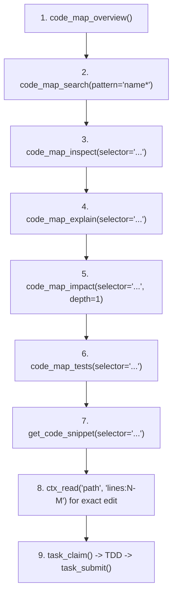

# ContextUnity Forge MCP

`contextunity-forge` provides high-performance semantic code-graph querying, architectural inspection, impact analysis, and **ACDD (Augmented Context-Driven Development)** task coordination for repositories indexed by Forge.

## Documentation layers

Every indexed repository uses these roles. Create a directory only when it has pages. A page states current behavior or a command.

| Path | Contains |
| --- | --- |
| `docs/AGENTS.md` | Authoring rules for that tree |
| `docs/README.md` | Navigation |
| `docs/roadmap.md` | One or two strategic paragraphs |
| `docs/architecture/` | Current system topology |
| `docs/adr/` | Accepted decisions |
| `docs/reference/` | Interfaces: configuration, CLI, tools, and schemas |
| `docs/runbooks/` | Commands and operational sequence for that repository |
| `docs/testing/` | How that repository verifies |
| `docs/milestones/` | Admitted commitments. `archive/` keeps receipts |
| `docs/plans/` | Proposals before admission |
| `docs/archive/` | Retained history outside the documentation index |

The repository `AGENTS.md` names the verification command and the Git permission. The Forge binary's schemas stay in the Forge repository's `docs/reference/`. Indexer markup for pages Forge searches is in the Forge repository's `docs/AGENTS.md`.

## Forge MCP Server & CLI Dual-Surface Binding

> **CRITICAL DIRECTIVE**: Agents **MUST** use registered `contextunity-forge-mcp` MCP tools as the primary mechanism for code discovery, architecture inspection, documentation search, and task lifecycle operations whenever the server is active. Do NOT fallback to ad-hoc scripts or raw `grep` for code discovery unless Forge is unavailable.

- **MCP & CLI Dual-Surface**: Use registered Forge MCP tools or the CLI (`contextunity-forge-mcp`) on the surface providing the required operation.
- **Server Identity**: The MCP server is typically registered as `contextunity-forge` or `contextunity-forge-mcp`; use the active registry and tool schemas.
- **Repository Setup**: Repositories declare tool routing using the canonical template in [references/agents.md.example](references/agents.md.example).
- **CLI-Only Operations**: Milestone lifecycle commands (`milestone init/list/show/handoff-context/handoff`) are intentionally CLI-only.
- **Task Dispatch**: `task next --worker WORKER --worktree PATH [--workspace WS]` and `task_manage(action: "next", worker_id, worktree, workspace?)` atomically claim the next eligible task. Both return claim context or `status: "idle"`; a parked task resumes in its retained worktree.
- **CLI Task Aliases**: `task show TASK_ID` aliases `task inspect TASK_ID`. Inspect and submit accept `--task TASK_ID` instead of the positional ID; sync accepts `--file PATH` instead of the positional milestone reference. Use `task list --detail compact|full`; `--full` remains supported and cannot combine with `--detail`.
- **AST Surfaces**: Use MCP `ast_grep_search(pattern, path="file.rs")` to infer the language from a recognized file extension, or supply `language` explicitly. CLI uses `contextunity-forge-mcp ast grep --lang rust --path file.rs 'PATTERN'`; `--lang` is required on the CLI.
- **Session Kickoff**: Start with `code_map_overview()` to verify active workspace, components, and indexing coverage.
- **Hot Reload**: On Unix, `contextunity-forge-mcp reload` sends `SIGHUP` to running servers, replacing the executable in-place without breaking client connections.

## Core Operational Boundaries

- **SQLite Timeout**: 2.0 seconds per query. Unbounded queries fail fast.
- **Output Limit**: Responses capped at 64 KiB.
- **Pagination**: Default page size is 30 items (max 100).
- **Continuation**: When `next_offset` > 0, supply `offset=next_offset` AND `generation="<token>"` from the previous page to continue.
- **Detail Mode**: Use `detail="compact"` on broad queries to avoid payload overflow. Use `detail="full"` only when inspecting single entities.
- **Budget Recovery**: If a query times out or exceeds budget, narrow `selector`/`path` or reduce `depth` (e.g., `depth=1`).
- **Impact Change Views**: `code_map_impact` takes exactly one symbol `selector` or Git `changes` mode (`staged`, `unstaged`, or `head`); its continuation generation binds the graph and captured change snapshot. Review `unmapped_changes` and `complete` before treating the result as exhaustive.

---

## Canonical Discovery Workflow



1. **Orient**: `code_map_overview()`
   - Verify `workspace_root` matches the active worktree.
   - Check indexed coverage and components before making claims about absence.
2. **Locate**: `code_map_search(pattern="Token*", detail="compact")`
   - Use prefix wildcard (`prefix*`) or full-text terms.
   - Retrieves matching symbols with kinds, paths, and fully-qualified selectors.
3. **Inspect**: `code_map_inspect(selector="function:...")`
   - Reads exact definition, signature, docstring, and declared architectural invariants.
4. **Relate**: `code_map_explain(selector="...")`
   - Unveils symbol ownership, direct callers (inbound), callees (outbound), and invariants.
5. **Blast Radius**: `code_map_impact(selector="...", depth=1)`
   - Traces inbound dependency chains before modifying or removing symbols.
   - Keep `depth=1` initially to avoid combinatorial explosions.
6. **Tests**: `code_map_tests(selector="...", direction="inbound")`
    - Inbound follows exact `calls` edges from classified `test_case` roots and returns the shortest `call_path`; helpers and fixtures may appear within a path but are not coverage roots. Outbound follows exact calls from a test into production code. `possible_calls` and lexical fallback suggestions do not prove coverage; a bounded lexical suggestion has no `call_path`.
7. **AST Preview**: `get_code_snippet(selector="...")`
   - Reads a bounded source preview (5 leading + 200 body lines by default; requested body lines clamp to 1..500, within byte caps).
8. **Verify Source**: Use `ctx_read` for exact source ranges before editing.
9. **Task Lifecycle**: Claim, execute, and submit tasks via ACDD gates.

---

## ACDD

ACDD connects Git milestone contracts (`docs/milestones/*.md`) to a task queue in SQLite (`.forge/tasks.sqlite`). A code-index rebuild does not reset task state. The Forge repository's [task reference](https://github.com/ContextUnity/contextunity-forge-mcp/blob/main/docs/reference/tasks.md) owns operation and evidence schemas.

The shared skill provides generic Forge MCP and CLI guidance. The active task profile and the current claim's `workflow_guidance` own gate identifiers and order, proof policy, role and model selection, review contours, and profile-specific behavior. Follow those returned instructions; do not infer a fixed workflow from this skill. Use [references/acdd_profile.yaml.example](references/acdd_profile.yaml.example) only as a profile configuration example.

The repository `AGENTS.md` names this skill, local verification instructions, and standing Git permissions (see [references/agents.md.example](references/agents.md.example)). It does not restate this procedure. Install the skill at `~/.agents/skills/contextunity-forge/SKILL.md` or `.agents/skills/contextunity-forge/SKILL.md` in the repository. Claim and inspect return `TASK_GUIDANCE_MISSING` when the configured guidance file is missing, does not name the skill, or the skill is not installed.

### Documentation and instructions co-evolution

A task that changes observable behavior, public interfaces, workflows, configuration, or operational assumptions updates the corresponding documentation and agent instructions during its configured build stage. Include affected documentation files in the task's initial `scope:` at milestone design time, or admit them via `extend_scope` before editing; do not defer documentation updates caused by the task's own contract.

Task claims inject standing runtime guardrails into `workflow_guidance.rules`:
- `PROTECTED`: Milestone `id`, `invariants`, `owners`, `depends_on`, and `acdd_profile` are immutable while tasks are active.
- `ISOLATION`: Develop exclusively inside the assigned dedicated worktree.
- `IMMUTABILITY`: Keep admitted scope unchanged after review pass and during deliver.
- `INDEPENDENCE`: Review stage requires a worker_id distinct from the accepted builder.
- `NO_PREFLIGHT_SUBAGENTS`: Start the active gate work without launching preflight subagents.
- `NEVER_EDIT_RECEIPTS`: Never manually edit receipt: or status: blocks in docs/milestones/*.md; task_submit(stage=deliver) writes and commits receipts automatically.

The embedded profile has `contract_author`, `builder`, and `independent_reviewer` subagent roles. The contract author posts the draft on the task blackboard with `topic=draft` and `gate=build`; the same independent reviewer session continues through review and delivery. Registered command guidance includes scoped test commands, and `expected_evidence_template` is bound to the active task, stage, revisions, worker, and worktree. Contract/build context carries indexed `external_callers`, direct and two-hop `covering_tests`, and ADR invariant summaries. Contract seams must reach an in-scope production symbol; changed public signatures with out-of-scope indexed callers fail with `TASK_SEAM_DISCONNECTED` or `TASK_SCOPE_INCOMPLETE` as applicable. For greenfield features where admitted scope files do not exist yet on disk, the contract author creates minimal file scaffolding with compiling production stubs and module/import declarations in admitted scope so AST imports resolve before index refresh.

Lifecycle errors follow a deterministic single-line format: `{CODE}: {task_id}. {facts}. Do: {action}` (or action- and milestone-scoped equivalents). Structured `AUTHORITY_GAP` diagnostics distinguish milestone frontmatter divergence from task specification changes with exact remediation commands.

### Tests

Keep each admitted task focused on one public production seam; add subtask cases to that seam. Drive tests through real collaborating components and domain test suites rather than synthetic stubs mocking away system complexity. Drive permutations and error codes through structured test case tables. Reuse shared fixtures, test harnesses, and temporary directories. The repository's test instructions (`TESTS.md`, `tests/AGENTS.md`) name the test domains and commands.

### Scope

Stay inside the admitted scope. Use `task_manage(action=extend_scope)` to add paths before editing outside the task's current scope. Follow the active contract and profile for scope roots and revision requirements.

### Subtasks

Record discoveries with `task subtask add`. Do not add a root milestone task for them. `context_bundle.guidance.subtask_dod` is advisory. A status update records the caller-provided status and evidence and does not score it.

Use `ready`, `in_progress`, `completed`, `cancelled`, or `blocked` for subtasks.
New subtasks default to `ready`; legacy `pending` is accepted as an alias and
responses use `ready`. Reserve `parked` for top-level task worktree affinity.
Cancelled tasks retain their history and do not satisfy dependencies or enter
dispatch. Follow the task reference for cancellation through specification sync
and explicit reset/reopen; reopen a terminal parent before editing its subtasks.

- Contract slice resolution: Demonstrably resolves an explicit, bounded slice of the contract without breaking boundaries.
- Milestone and ADR alignment: Builds upon existing architectural seams rather than ad-hoc isolated patches.
- Production-seam evidence: Validates through real production paths rather than synthetic stubs mocking away system complexity.
- Systemic non-regression: Preserves existing behavior and untouched invariants.
- Anti-looping invariant: Retain fail-closed boundaries and escalate via `task_blackboard` when repeated attempts stall.

### Blackboard

Post and read messages at milestone, task, and subtask scope. Use only `draft`, `notes`, `findings`, `blockers`, `decisions`, and `deferred`; post/read may target or filter by a gate id from the active task profile. Claims include untargeted messages plus those targeted to the current gate, and expose the targeted set through `workflow_guidance.blackboard_messages` with a compact `blackboard_info` summary. Delivery copies `decisions` and `deferred` into the existing `architectural_notes` receipt vector with topic labels before clearing that task's messages.

### Delivery and milestone handoff

The active delivery profile controls whether Forge automatically commits the candidate tree during delivery:

- With `auto_commit: true`, Forge automatically creates the delivery commit and records the receipt in SQLite; do not create duplicate task commits.
- With `auto_commit: false`, Forge records the delivery receipt in SQLite without creating a commit; create the scoped task commit under repository-owned Git permissions.

Before milestone handoff, follow the repository's documentation-scan instructions.
The coordinator launches a documentation agent using `agent-instructions` against
the final milestone diff and admitted documentation scope. Record its result on
the milestone blackboard and review its edits before final verification; Forge
does not launch the agent or add a milestone gate.

Commit the final implementation, prepare its binding, obtain independent integration
review, and run repository verification against the same content and target base:

```sh
contextunity-forge-mcp milestone handoff-context <id> --target-base main > /tmp/handoff-context.json
# The coordinator supplies completed external review and verification evidence.
contextunity-forge-mcp milestone handoff <id> --evidence-file /tmp/handoff-evidence.json
```

Use the repository task reference for the typed record fields and canonical
projection. The integration reviewer differs from all accepted task builders.
Preserve accepted task proofs; rebase, cherry-pick, merge and multi-task squash
may change optional navigation SHAs without reopening completed tasks. Changed
content or authority needs fresh final review and verification. Forge retains
required proof objects independently of branch history, validates the supplied
record and archives it; it launches no agents and runs no tests. Commit the
archived manifest and the working manifest removal afterward. Follow repository
Git permissions for landing and cleanup.


## Workspace Adapters (`forge-mcp.yaml`) & Default Behavior

### Where Adapters Live
- Primary adapter: `forge-mcp.yaml` in the repository root.
- Linked adapters: sibling repositories configured under `linked_workspaces`.
- Starter file generation: `contextunity-forge-mcp guide init`.

### Connecting Adapters
```yaml
roots:
  - src
docs:
  - docs
milestones:
  - docs/milestones
plans:
  - docs/plans
ignore:
  - target
  - node_modules
linked_workspaces:
  - name: shared-core
    path: ../shared-core
    enabled: true
    roots:
      - src
    tasks:
      enabled: true
      milestones_dir: docs/milestones
      agents_guidance: AGENTS.md
tasks_db: .forge/tasks.sqlite
task_repository: forge-mcp
task_project: forge-mcp
agents_guidance: AGENTS.md
response:
  page_size: 30
  max_output_bytes: 65536
```

### Default Behavior (Without `forge-mcp.yaml`)
- **Code Graph**: Scans workspace root (`.`), respects `.gitignore`, excludes common build/cache folders (`target`, `node_modules`, `.git`, `.venv`, `__pycache__`), and outputs `.forge/code-map.sqlite`.
- **Tasks Database**: Defaults to `.forge/tasks.sqlite`.
- **Git Worktrees Auto-Resolution**: Relative `tasks_db` paths resolve to the primary worktree root, so parallel workers share the task database. Code-tool worktree selection is described under Discovery & Search below.
- **Identity Defaults**: `task_repository` and `task_project` default to `forge-mcp`; `agents_guidance` defaults to `AGENTS.md`; milestone directory defaults to `docs/milestones/`.

---

## Declarative framework packs

Project rules live in each workspace's `.forge/frameworks/<framework-id>.toml`, `.yaml`, or `.yml`. Start with the equivalent [TOML](references/frameworks/declarative-rules.toml.example) or [YAML](references/frameworks/declarative-rules.yaml.example) examples for class receivers, route decorators, route calls, dependency-injection calls and imported calls to actual template files. Keep the four legacy arrays (`receivers`, `builtins`, `filters`, `routes`) even when empty. Project rules extend the bundled identifier by default; `replace = true` replaces it. Rebuild or update the index after editing rules.

The Forge repository's [framework manifest reference](https://github.com/ContextUnity/contextunity-forge-mcp/blob/main/docs/reference/framework-manifests.md) owns the schema, merge identities, activation rules, and validation limits. Use manifests for data supported by existing language hooks; a new language or new extraction semantics requires profile code and production-seam proof.

Read `framework_rule_diagnostics` in actual build and delta reports after replacing bundled rules. Compare removed eligible identities rather than rule counts; clean reports contain an empty list. These diagnostics are ephemeral and do not belong in parser errors or persisted facts. Effective typed rules compile against the actual Tree-sitter grammar and invalidate with registry changes.

For structural language support, supply the six `SyntaxGrammarSpec` categories and use the shared `SinglePassExtractor` enter/exit owner frames. Keep language-specific body events and linker semantics in their existing owners. Preserve public facts and all commitment domains against the delivered baseline; do not implement a new recursive body collector. Tree-sitter query experiments remain opt-in research outside default indexing.

## MCP Tool Reference

### Operational Task Lifecycle
- `task_list(repository?, milestone_ref?, milestone_status?, status?, stage?, detail?)`: Query task cards; defaults to ready tasks in active milestones. `milestone` is accepted as an alias for `milestone_ref`; `status: "cancelled"` selects retained cancelled tasks.
- `task_claim(task_id, stage, worker_id, worktree, bundle?)`: Claim the current gate; returns stage-specific guidance and context bundles.
- `task_submit(task_id, stage, action, evidence, findings?)`: Submit claim-bound JSON proof or review findings.
- `task_manage`: Manage tasks via flat actions (`create`, `sync`, `inspect`, `context`, `next`, `delete`, `extend_scope`, `subtask_add`, `subtask_update`, `subtask_list`, `reset`, `reopen`).
- `task_blackboard`: Post/read/inspect messages at `milestone`, `task`, or `subtask` scope. Post/read may include `gate` to target or filter messages by an active profile gate. Runtime topics are `draft`, `notes`, `findings`, `blockers`, `decisions`, and `deferred`; the last two are copied to the existing `architectural_notes` receipt vector with topic labels. Claims include untagged messages plus those targeted to the active gate, with targeted messages also listed in `workflow_guidance.blackboard_messages` and a compact `blackboard_info` summary.

`task_list` accepts `parked` to select tasks waiting for a scope owner while retaining worker/worktree affinity. `task next --worker WORKER --worktree PATH [--workspace WS]` exposes the same atomic dispatch as `task_manage(action: "next", worker_id, worktree, workspace?)`; it prioritizes independent delivery, independent review, the requesting worker's unblocked parked work, then ordinary ready work by wave and task ID. It returns claim context or `status: "idle"` when no work is eligible.

### Discovery & Search
Code discovery and inspection tools accept `worktree`: an absolute or server-relative path, exact directory name, or unique hyphen-delimited name suffix. Without it, retain the server's linked worktree; otherwise use one unique active claimed worktree when workspace configuration is loaded or `forge-mcp.yaml` exists (an empty `{}` file suffices). Without configuration or an active claim, retain the primary root. Multiple active directories or matching names return `WORKTREE_AMBIGUOUS`; pass an explicit path/name. Use `worktree: "."` for the server root. MCP requests do not transmit the client's current directory.
- `code_map_overview(aspects?, worktree?, limit?, offset?, detail?, generation?)`: Workspace component inventory, module hierarchy, indexing metrics, coverage diagnostics, paged `analysis_gaps`, and persisted `coverage_by_workspace` counts.
- `code_map_search(pattern, kind?, path?, exact?, include_docs?, include_preview?, group_by_file?, worktree?, detail?, limit?, offset?, generation?)`: Full-text and prefix symbol search; `query` is accepted as an alias for `pattern`. Use `exact=true` for an indexed name or qualified name, or `pattern="*"` with a `path` or `kind` scope to list symbols. An empty `path` leaves results unfiltered. Results include signatures and `inspect_selector`; source previews appear automatically for at most three total hits, or on request via `include_preview=true` for larger result sets, capped at three previews.
- `ast_grep_search(pattern, language?, path?, worktree?, detail?, limit?, offset?, generation?)`: Tree-sitter AST syntax matching with `$NAME` and `$$$ARGS` captures. Omit `language` only when `path` has a recognized file extension; otherwise use a compiled profile ID from `code_map_overview`.
- `search_docs(query, doc_type?, component?, worktree?, limit?)`: Full-text search across documentation, guides, and ADRs.
- `get_doc(path_or_id, section?, worktree?)`: Read indexed markdown doc or exact heading anchor.

### Inspection & Hierarchy
- `code_map_inspect(selector, worktree?, include_coverage?, show_doc?, show_source?, leading_lines?, max_body_lines?)`: Symbol summary, receiver metadata, exact callers/callees, paged `analysis_gaps` (e.g. `trait_object_dispatch`, `macro_expansion_not_analyzed`), and candidate dispatch targets (`possible_calls`).
- `get_code_snippet(selector, worktree?, leading_lines?, max_body_lines?, source_offset?, generation?)`: Bounded, digest-verified AST source preview.
  Preview line budgets for inspect and snippet requests are clamped to supported bounds. Continue a truncated preview with the returned `next_source_offset` as `source_offset` and the same `generation`.
- `code_map_explain(selector, direction?, worktree?, include_coverage?, show_doc?, show_source?)`: Direct relationships with both public endpoint IDs and query-relative direction, candidate dispatch edges, symbol ownership, and architectural invariants; full detail includes stored edge evidence.
- `code_map_impact(selector?, changes?, direction?, depth?, worktree?, detail?, limit?, offset?, generation?)`: Inbound blast radius (`direction="inbound"`, default, traversing both exact `calls` and candidate `possible_calls`), outbound dependencies, or a staged/unstaged/HEAD Git change view. Depth-one non-seed nodes carry their selected edge endpoints, direction, location, and confidence. A change range maps only when its selected postimage matches the indexed file; inspect `unmapped_changes` and `complete`.
- `code_map_tests(selector, direction?, worktree?, detail?, limit?, offset?, generation?)`: Find verified test cases connected by exact call paths, or production dependencies reached from a test. Test roles distinguish cases, helpers, and fixtures; a bounded inbound lexical fallback can suggest cases when no graph path exists.

### Verification & Safety
- `code_map_prove_removal(selector)`: Proves whether a symbol can be safely removed based on static references; treats candidate callers (`possible_calls`) as potential incoming dependencies that block safe removal.
- `code_map_analyze(target, lint?, include_cycles?)`:
  - `target=""`: Workspace-wide diagnostics and syntax errors.
  - `target="path/to/file.py"`: File-scoped diagnostics with digest-verified source snippets and evidence-backed reasons when known.
  - `untested_public_surface`: Paged declared-public production symbols in the selected path scope that no indexed test case reaches through exact calls.
  - `lint=true`: Returns stored AST parse and syntax errors.
  - `include_cycles=true`: Detects dependency cycles.
- `code_map_query(operation, selector?, include_coverage?, depth?, limit?, offset?, generation?)`: Graph slices, unwired nodes, or read-only SQL (`operation="sql"`).
- `session_checkpoint(action, name?, content?)`: Manage workflow checkpoints in `.forge/checkpoints.json`.
- `forge_guide(topic?, force?)`: Interactive guidance (`topic="acdd"`, `"query"`, `"adapter"`, `"docs"`, `"ast"`).

---

## Resilient Selectors & Query Resolution

- **Exact ID**: Canonical node IDs (`function:src/scanner.rs:42:scan`, `class:...`, `module:...`).
- **File Paths**: `src/scanner.rs` automatically selects the module node. Strips `file://`, `file:`, and `./`.
- **Path + Symbol**: `src/scanner.rs:scan` resolves directly to the inner symbol inside the file.
- **Path + Line Coordinates**: `src/scanner.rs:42` or `src/scanner.rs#L42` resolves to the innermost AST node spanning that line.
- **Bare Names**: Reported with candidate IDs when ambiguous; never hijacked into modules.
- **Documentation**: Selectors ending in `.md` automatically direct agents to `get_doc` or `search_docs`.
